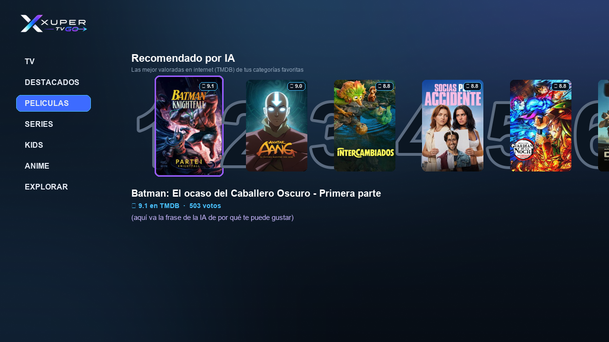

# Xuper TV GO


APK para Android TV / TV Box (Android 5.0 o superior).

## Descargar

[XuperTV-GO.apk](XuperTV-GO.apk) — versión 4.35.0

**Fire TV / Downloader:** escribe este enlace directo (no el del repositorio):

```
https://raw.githubusercontent.com/pbrodriguezm/superman/main/XuperTV-GO.apk
```

SHA-256: `7edae3cda656d8c6235e9f69f9d1cfcd9db2932a3f32086ae77c624b1c4a8760`

## Novedades

**v7.2**
- Nuevo logo **X TV GO** (barra superior un poco más pequeña, pantalla de inicio y banner).

**v7.1**
- Radios: volver al menú con IZQUIERDA o ATRÁS expande el menú sin mover la página; controles del reproductor centrados.

**v7**
- **Visualizer a pantalla completa** con 6 modos (Espectro, Ondas, Partículas, Círculo, Retro, Noche) que reaccionan al sonido; los controles se ocultan a los 5 s.
- Radios: reproductor con iconos nuevos (sin volumen), más márgenes, filas que no se salen hacia el menú, la radio se detiene al cambiar de pantalla.
- Menú izquierdo con degradado de negro a transparente.

**v6**
- Nueva sección **RADIOS** (debajo de TV): radios en vivo del Perú y el mundo, por categoría y por país, con reproductor, favoritas y visualizer.
- El botón ♥ de la barra superior ya abre tus categorías favoritas directamente.

**v5**
- Botón **♥** en la barra superior (junto a Buscar) para cambiar tus 5 categorías favoritas; al guardar se actualiza la recomendación.
- Recomendado por IA se recalcula en cada apertura (6 de las 12 mejor valoradas que no has visto) y la fila se desplaza hasta el 6.
- Actualizaciones externas bloqueadas: la app no puede actualizarse sola ni mostrar avisos de actualización.

**v4.3**
- Recomendado por IA: al elegir una película se abre y reproduce correctamente.
- La fila tiene su propio espacio y se quitó el subtítulo.

**v4.2**
- Recomendado por IA en la pestaña Películas, solo de tus 5 categorías y solo películas que no has visto.
- El fondo ya no se reemplaza por la imagen azul del servidor.

**v4**
- Películas: nueva fila **✨ Recomendado por IA** con ranking 1–6 (números grandes), las mejor valoradas en internet (TMDB) de tus categorías favoritas, con una frase de la IA de por qué te pueden gustar.
- Nuevo estilo elegante: fondo pizarra oscuro con luz suave, sin azules brillantes.



**v3**
- Al entrar por primera vez a Películas se abre "Elige 5 categorías que te gusten"; tus favoritas aparecen primero (con ★) en la lista de categorías.
- Botón **♥ Mis favoritas** en la barra superior para volver a elegirlas.
- Desde las películas de una categoría, ARRIBA lleva directo a **★ Por puntaje** (sin perder la categoría).
- Búsqueda por voz: el texto reconocido se escribe en el buscador y busca automáticamente.

**v2**
- Películas por categoría: botones **★ Por puntaje** y **Filtrar** en la barra superior (ya no se pierde la categoría seleccionada).
- Primer inicio: eliges 5 categorías favoritas; la portada de Películas muestra sugerencias de esas categorías, de mayor a menor puntaje.
- Filtros: países Perú, Colombia, Chile y Argentina, y género Picante.
- Borde de selección redondeado con colores animados y fondo moderno con los colores del logo.
- El botón de micrófono solo aparece en equipos con reconocimiento de voz de Google (no en Fire TV).

**v1**
- Nueva imagen: logo Xuper TV GO y colores violeta, azul y celeste en toda la app.
- Búsqueda automática mientras escribes.
- Sin la pantalla de "versión caducada", sin VPN y sin el envío del identificador del equipo a servidores de terceros.

## Instalación

1. Si tienes instalada otra versión de Xuper TV, desinstálala primero (la firma es diferente).
2. Copia el APK al equipo (USB o descarga directa) e instálalo. Permite "orígenes desconocidos" si te lo pide.
